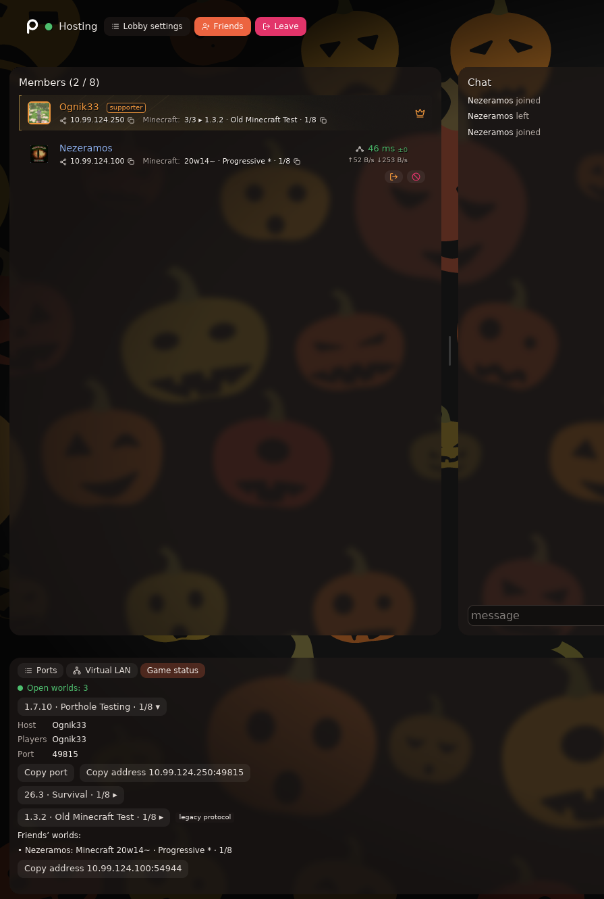

# Game status - a Porthole add-on

[Русский](README.ru.md)

Shows badges for open game worlds in a [Porthole](https://store.steampowered.com/app/4963920) lobby: version, world name and players online. Friends who also have the add-on see your worlds and can copy the address to join with one click.



## Features

- Finds Minecraft Java worlds opened with “Open to LAN” on its own - from 1.3 to 26.x and snapshots. Understands launcher windows (MultiMC, Prism and others) and `java.exe`: such ports are checked first and shown only if they really are Minecraft.
- Badge in the member list: `Minecraft: 26.3 · Survival · 2/8`. Several worlds of one game share one badge that cycles through them (`1/3 ▸ …`).
- “Game status” tab: one button per world; press it for host, players and port, plus “Copy port” and “Copy address”.
- Friends’ worlds with a “Copy address 10.99.x.x:port” button for Direct Connect over Porthole’s virtual LAN.
- Settings: cycle worlds, show players, **hide names for streaming**.
- UI in English, Russian, Ukrainian and German.

## Install

1. Download `game-status-<version>.paddon` from [Releases](../../releases).
2. **Leave the lobby** (add-ons can’t be changed while you’re in one).
3. Porthole → Settings → Add-ons → “Install from file”, or drag the file onto the window.
4. Enable it, start a lobby and open a world to LAN.

To update, install the new version over the old one. Friends need a compatible version: 0.2.x doesn’t see 0.1.x.

## Permissions and why

| Permission | Why |
|---|---|
| `ui` | badges and the tab |
| `identity`, `roster` | who you are and who is in the lobby, to put a badge on the right person |
| `net` | share world status with the same add-on on friends’ PCs |
| `system` | see which programs listen on ports (`on_listening`) and send commands to the add-on’s own helper on `127.0.0.1` |
| `run_helper` + `natives` | run `game_probe.dll`: world queries, the virtual LAN adapter’s address, copying to the clipboard |

No administrator rights. The add-on doesn’t go online and doesn’t read your files. `game_probe` only connects to ports on your own PC and sends the same request the in-game server list does. Its command port listens on `127.0.0.1` only and accepts commands only with a random token the add-on knows.

## How it works

- **Luau** (`src/*.luau`, bundled into one `main.luau` at build time) finds candidates in `on_listening` using game profiles, sends the helper the desired list of worlds, draws the UI and shares state with friends.
- **game_probe** (`native/game_probe.c`, C + [cJSON](https://github.com/DaveGamble/cJSON)) - one process per session. One thread per world, so a stuck world doesn’t slow the others. Commands require a random token; events are text lines on stdout. For Minecraft it speaks three generations of the protocol and handles worlds that listen only on the home network address (old versions).
- **Member protocol `gs3`**: schema version, only the fields needed, sequence number and epoch, a heartbeat every 30 seconds, expiry after 90, a 4096-byte message limit, validation of everything received.
- **Game profiles** - `games.toml`: label, window or process hints and the query module. A new game on an already supported protocol is a new entry in the file.

## Building and tests

Needs `mingw-w64`, `python3`, `zip` (Linux or WSL), and [`luau`](https://github.com/luau-lang/luau/releases) for the Luau tests:

```bash
sudo apt install gcc-mingw-w64-x86-64 zip python3
./tools/build.sh   # -> dist/game-status-<version>.paddon, dist/game_probe_cli.exe
./tools/test.sh    # probe vs fake servers, agent protocol, Luau tests
```

The build is reproducible: the `.paddon` in Releases (built by GitHub Actions from this code) is bit-for-bit identical to a local build with the same compiler.

`game_probe_cli.exe` is the same probe as a standalone program for diagnostics, e.g. `game_probe_cli.exe --debug --status minecraft 51807`.

## Compatibility and limits

- Tested on Porthole 3.0.2, add-on API version 1. SeStudio calls the API unstable, so a Porthole update may need a fix here.
- Windows only (Linux is planned).
- Minecraft Java only for now. More games are planned.
- Only members who have the add-on see the badges.

## Roadmap

- Precise LAN world discovery from their network announcements - automatic when Porthole already has firewall permission.
- Games on Valve A2S (Valheim, Rust and others).

## License

[MIT](LICENSE). cJSON is MIT, © Dave Gamble and contributors (`native/third_party/cJSON/LICENSE`).

Unofficial add-on, not affiliated with SeStudio or Mojang.
